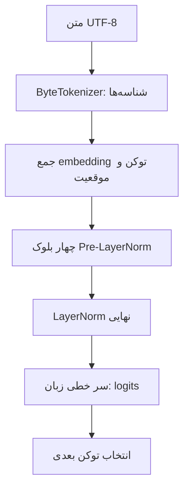

# MiniCoder Brain — نسخهٔ ۱٫۱، پیکرهٔ آموزشی پایتون

نسخهٔ `1.1.0` یک مدل کوچک GPT با وزن‌های ساخته‌شده از ابتدا، دادهٔ محلی، موتور آموزش و تولید، و سامانهٔ ارزیابی قابل بررسی است. این نسخه پیکرهٔ قطعی پایتون و ابزار آزمایش تکرارپذیر را اضافه می‌کند؛ معماری مدل و توکن‌ساز ثابت مانده‌اند. هدف پروژه فهم اجزای مدل زبانی است. همهٔ اجراها روی CPU و آفلاین‌اند؛ وزن آماده، سرویس ابری، Ollama یا دانلود خودکار داده وجود ندارد.

**مدل پایهٔ گزارش انتشار ۱٫۰ آموزش‌ندیده است.** مثال‌های آموزشی و تست‌ها آموزش‌های کوتاه ساختگی انجام می‌دهند، اما این نتیجه‌ها به‌عنوان دانش یا وزن آموزش‌دیدهٔ مدل پایه معرفی نمی‌شوند. گزارش تاریخی در [Markdown](reports/phase_12_release.md) و [JSON](reports/phase_12_release.json) موجود است. آزمایش کوتاه پنج‌گامی پایتون اکنون checkpoint مستقل دارد؛ آزمایش جدید ۵۰۰گامی آماده شده و هنوز آغاز نشده است. آماده‌سازی این آزمایش شاهد بهبود کیفیت نیست.

## آماده‌سازی پایتون ۱٫۱

پروفایل مستقل [آزمایش کنترل‌شدهٔ ۵۰۰گامی](docs/python_v1_1_step500.md) نیز آماده است؛ فرمان آغاز دستی و ارزیابی بدون test در آن آمده است. افزودن این پروفایل آموزش را آغاز نمی‌کند و پیش‌فرض پنج‌گامی حفظ می‌شود.

[پیکرهٔ محلی](data/python_training/README.md) شامل ۳۲۰ نمونهٔ آموزش، ۴۰ اعتبارسنجی و ۴۰ آزمون در ده موضوع است. ۱۲۰ خانوادهٔ ساختاری پیش از ساخت نمونه‌ها جدا شده‌اند؛ بین بخش‌ها کپی عین، کپی با تغییر فاصله و ساختار AST مشترک شناسایی نشده است. هر نمونه حداکثر ۱۰۳ بایت UTF-8 دارد. [راهنمای کامل فارسی](docs/version_1_1_python_training.md) تولید، بازرسی، آزمایش طولانی دستی و محدودیت‌ها را توضیح می‌دهد؛ [گزارش آماده‌سازی](reports/version_1_1_preparation.json) نیز شمارش و نتیجهٔ آزمون‌ها را ثبت می‌کند.

ابتدا اعتبارسنجی و پیش‌نمایش بدون آموزش:

```powershell
.\.venv\Scripts\python.exe -X utf8 scripts/prepare_python_dataset.py --validate-only
.\.venv\Scripts\python.exe -X utf8 scripts/train_python.py --dry-run
.\.venv\Scripts\python.exe -X utf8 scripts/evaluate_python.py --dry-run
```

برای آغاز دستی یک آزمایش پنج‌گامی و سپس ارزیابی checkpoint حاصل:

```powershell
.\.venv\Scripts\python.exe -X utf8 scripts/train_python.py --steps 5 --checkpoint checkpoints/python_v1_1_step5.pt
.\.venv\Scripts\python.exe -X utf8 scripts/evaluate_python.py --checkpoint checkpoints/python_v1_1_step5.pt --trust-checkpoint --output reports/python_v1_1_step5.json --markdown reports/python_v1_1_step5.md
```

ابزار واسط، فهرست صریح فایل‌های train و validation را با قرارداد موجود `--files FILES [FILES ...]` به همان `scripts/train.py` می‌دهد و تفکیک ثابت را حفظ می‌کند. هیچ فایل test وارد آموزش نمی‌شود. شروع از وزن تصادفی است و checkpoint موجود بازنویسی نمی‌شود. برای اجرای طولانی‌تر، فرمان هزارگامی با مسیر تازه در راهنما آمده است. ارزیابی، greedy و نمونه‌گیری با بذر ثابت، خطا، perplexity، تکرار و نحو را گزارش می‌کند؛ test فقط با `--include-test` ارزیابی می‌شود. نتیجهٔ مجموعهٔ کامل فعلی: **۲۸۱ تست پاس، صفر شکست و خطا**.

## شروع و سخت‌افزار

محیط هدف Windows 11، Python 3.11، پردازندهٔ Intel Core i7-13700H و ۱۶ گیگابایت RAM است. GPU لازم نیست. PyTorch باید روی CPU کار کند. وزن‌های مدل پیش‌فرض حدود ۳٫۳۴ MiB هستند؛ حافظهٔ واقعی فرایند، فعال‌سازی‌ها، گرادیان‌ها و حالت AdamW بیشتر است. طول و اندازهٔ دسته، به‌ویژه به‌علت رشد مربعی توجه، بر حافظه و سرعت اثر دارند.

از پوشهٔ `MiniCoderBrain` کار کنید. اگر `.venv` موجود است، از همان محیط استفاده کنید. ساخت محیط و نصب اولیه فقط به‌صورت دستی انجام می‌شود:

```powershell
python -m venv .venv
.\.venv\Scripts\python.exe -m pip install -r requirements.txt
```

نصب بسته ممکن است اینترنت بخواهد؛ خود پروژه در اجرا به شبکه نیاز ندارد. هیچ اسکریپتی وابستگی را خودکار نصب نمی‌کند. دستورهای مستندات پایتون محیط را صریحاً انتخاب می‌کنند تا مفسر سراسری اشتباه اجرا نشود. پس از فعال‌سازی محیط، همین ورودی‌ها با `python scripts/train.py`، `python scripts/generate.py`، `python scripts/evaluate.py` و `python scripts/model_info.py` نیز قابل فراخوانی‌اند؛ تولید باید منبع مدل را با گزینه معرفی کند.

```powershell
.\run_tests.ps1
.\.venv\Scripts\python.exe -X utf8 scripts/model_info.py
.\.venv\Scripts\python.exe -X utf8 scripts/evaluate.py
```

`run_tests.ps1` وجود محیط و قابل بارگذاری بودن torch و pytest را بررسی می‌کند و کد خروج pytest را حفظ می‌کند. دو فرمان آخر بدون checkpoint فقط مشخصات و رفتار مدل تازهٔ آموزش‌ندیده را نشان می‌دهند.

## معماری



[ModelConfig](minicoder/model/model_config.py) قرارداد قابل تنظیم معماری و [MiniCoderGPT](minicoder/model/gpt.py) ترکیب ماژول‌هاست. تنظیمات پیش‌فرض:

| مشخصه | مقدار |
| --- | ---: |
| واژگان | ۲۶۰ |
| بُعد بردار | ۱۲۸ |
| بلوک ترنسفورمر | ۴ |
| سر در هر بلوک | ۴ |
| بُعد هر سر | ۳۲ |
| بُعد میانی پیش‌خور | ۵۱۲ |
| سقف زمینه | ۱۲۸ توکن |
| پارامترهای یکتا بدون اشتراک وزن | ۸۷۶٬۵۴۸ |
| پارامترها با `tie_weights=True` | ۸۴۳٬۲۶۸ |

اشتراک وزن به‌طور پیش‌فرض خاموش است. در صورت فعال شدن، جدول توکن و وزن سر خروجی واقعاً یک `Parameter` دارند؛ بایاس سر خروجی مستقل می‌ماند. شمارش استاندارد PyTorch آن پارامتر را یک بار حساب می‌کند. بافر ماسک و حالت بهینه‌ساز جزو پارامترهای مدل نیستند.

### توکن‌ساز و embedding

[ByteTokenizer](minicoder/tokenizer/byte_tokenizer.py) هر بایت UTF-8 را به شناسهٔ همان بایت در ۰ تا ۲۵۵ نگاشت می‌کند. `PAD=256`، `BOS=257`، `EOS=258` و `UNK=259` ثابت‌اند. فاصله، تورفتگی، بزرگی حروف و صورت یونیکد تغییر نمی‌کند و برای متن معتبر `decode(encode(text)) == text` برقرار است. UNK در کدگذاری متن معتبر لازم نیست، چون همهٔ بایت‌ها شناسه دارند.

جدول توکن شکل `(260,128)` و جدول موقعیت مطلق قابل یادگیری شکل `(128,128)` دارند. شناسه فقط شمارهٔ سطر است و بزرگی آن معیار معنایی نیست. جمع بردارهای توکن و موقعیت، ورودی `(B,T)` را به `(B,T,128)` تبدیل می‌کند. حرف فارسی معمولاً چند بایت و چند توکن دارد؛ طول زمینه بر حسب توکن بایتی است.

### توجه، پیش‌خور و بلوک

توجه با سه تصویر Q، K و V و عملیات صریح ساخته شده است:

`Attention(X) = softmax(mask(QKᵀ / √head_dim)) V`

آینده پیش از softmax با منفی بی‌نهایت مسدود می‌شود. چهار سر شکل `(B,4,T,32)` دارند؛ خروجی‌ها متصل و با تصویر خروجی ترکیب می‌شوند. پیاده‌سازی آمادهٔ attention استفاده نشده است. هستهٔ داخلی برای پایداری روی CPU با float64 حساب می‌کند و نتیجه به نوع ورودی برمی‌گردد.

پیش‌خور مسیر `128 → 512 → 128` با GELU دارد و ۱۳۱٬۷۱۲ پارامتر دارد. لایهٔ دستی آن از `Parameter` و `matmul` و بایاس ساخته شده است. هر بلوک از روابط زیر استفاده می‌کند:

`U = X + Attention(LayerNorm₁(X))`

`Y = U + FeedForward(LayerNorm₂(U))`

LayerNorm روی ویژگی‌های هر جایگاه کار می‌کند. توجه گذشته را ترکیب می‌کند، پیش‌خور ویژگی‌های هر جایگاه را تبدیل می‌کند و مسیر باقیمانده ورودی و مسیر مستقیم گرادیان را حفظ می‌کند. هر بلوک ۱۹۸٬۲۷۲ پارامتر دارد. چهار بلوک، نرمال‌سازی نهایی و سر خطی دارای بایاس، logits با شکل `(B,T,260)` می‌سازند.

## دادهٔ محلی و هدف توکن بعدی

[Pipeline داده](minicoder/data/dataset.py) فقط فهرست صریح فایل‌های UTF-8 را می‌خواند؛ پوشه پیمایش نمی‌شود و فایل پایتون به‌عنوان متن خوانده می‌شود. پیش‌فرض سقف هر فایل ۲ MiB و مجموع فایل‌ها ۸ MiB است؛ پنجره‌ها تنبل ساخته می‌شوند.

تفکیک آموزش و اعتبارسنجی **پیش از پنجره‌سازی و در مرز سندها** انجام می‌شود. نسخه‌های دقیقاً یکسان سند در یک گروه می‌مانند. نزدیک بودن دو متن یا بخش‌های مشترک آن‌ها خودکار تشخیص داده نمی‌شود. دادهٔ واقعی را از نظر تکرار، اطلاعات محرمانه و حق استفاده بازبینی کنید. بررسی ابتدایی الگوهای گذرواژه و کلید API جای بازبینی انسان را نمی‌گیرد؛ محلی بودن فایل نیز به‌تنهایی مجوز آموزش نیست.

برای `T=128`، یک پنجرهٔ کامل **۱۲۹ توکن** لازم دارد:

```python
input_ids = sequence[:, :-1]  # ۱۲۸ توکن
target_ids = sequence[:, 1:]  # ۱۲۸ هدفِ یک توکن جلوتر
```

هدف‌ها فقط در dataset جابه‌جا می‌شوند؛ مدل و Trainer شیفت دوم ندارند. `stride=1` پنجرهٔ لغزان، `stride=T` قطعه‌های ورودی جدا با یک توکن مرزی مشترک و `stride=T+1` پنجره‌های کاملاً جدا می‌دهد. انتهای کوتاه می‌تواند با `pad` از راست پر یا با `drop` حذف شود. DataLoader با بذر و مکان دستهٔ قابل ذخیره، نمونه‌گیری تکرارپذیر دارد.

فایل‌های `examples/synthetic` صریحاً ساختگی‌اند: فارسی، انگلیسی، پایتون و متن ترکیبی. این پیکره برای مدل عمومی کافی نیست. گزینهٔ BOS/EOS در داده قابل تنظیم است؛ فرمان آموزش آن را روشن می‌کند.

## آموزش و checkpoint

اجرای پیش‌فرض فقط پنج گام کوتاه روی دادهٔ ساختگی است:

```powershell
.\.venv\Scripts\python.exe -X utf8 scripts/train.py
```

پیش‌فرض موتور: دستهٔ ۲، نرخ `3e-4`، AdamW با `betas=(0.9,0.95)`، واپاشی ماتریس‌ها `0.01`، سقف نرم گرادیان ۱ و دو رشتهٔ CPU. فرمان کوتاه از طول ۳۲ استفاده می‌کند. این‌ها **پیش‌فرض یک اجرای احتمالی** هستند، نه تنظیمات آموزش انجام‌شدهٔ مدل پایهٔ گزارش انتشار.

هر گام، پاک‌سازی گرادیان، forward، cross-entropy، backward، clipping و تغییر پارامتر را انجام می‌دهد. اعتبارسنجی بدون گرادیان و با وزن تعداد هدف غیر PAD است. خطا، perplexity، شمار هدف‌های پردازش‌شده، نرم گرادیان و مدت فعال ثبت می‌شوند.

```powershell
.\.venv\Scripts\python.exe -X utf8 scripts/train.py --checkpoint checkpoints/smoke-step5.pt
.\.venv\Scripts\python.exe -X utf8 scripts/train.py --resume checkpoints/smoke-step5.pt --steps 20 --checkpoint checkpoints/resumed-step20.pt
```

checkpoint کامل شامل مدل، AdamW، گام، تنظیمات، معیارها، RNG و مکان نمونه‌گیر است. نوشتن موقت و انتشار اتمی، مقصد موجود را جایگزین نمی‌کند؛ همیشه نام تازه بدهید. ادامه با داده یا تنظیمات ناسازگار رد می‌شود. `--steps 20` یعنی گام کل ۲۰، نه ۲۰ گام اضافه. در محیط یکسان، ادامه از وسط یا مرز epoch با اجرای بدون توقف تست شده است.

برای دادهٔ خودتان فایل‌ها را صریحاً با `--files` بدهید. اجرای طولانی فقط با فرمان آگاهانه انجام می‌شود؛ مثلاً:

```powershell
.\.venv\Scripts\python.exe -X utf8 scripts/train.py --steps 500 --sequence-length 128 --batch-size 2 --eval-interval 50 --checkpoint checkpoints/run-step500.pt
```

## تولید متن و UTF-8

منبع مدل باید صریح باشد: checkpoint کامل محلی مورد اعتماد یا مدل تصادفی برای مشاهدهٔ سازوکار.

```powershell
.\.venv\Scripts\python.exe -X utf8 scripts/generate.py --untrained --prompt "سلام" --max-new-tokens 8 --utf8-errors backslashreplace
.\.venv\Scripts\python.exe -X utf8 scripts/generate.py --checkpoint checkpoints/smoke-step5.pt --trust-checkpoint --prompt "سلام" --strategy sample --temperature 0.8 --top-k 40 --top-p 0.9 --seed 42 --max-new-tokens 32 --stream --utf8-errors backslashreplace
```

موتور تولید در eval و `torch.inference_mode()` اجرا می‌شود، EOS را رعایت می‌کند و فقط آخرین توکن‌های زمینه را به مدل می‌دهد. انتخاب greedy قطعی است؛ در sample دما، Top-K و سپس Top-P روی توزیع اعمال می‌شوند. مولد اختصاصی CPU با بذر ثابت، RNG سراسری را تغییر نمی‌دهد.

یک بایت لزوماً یک حرف نیست. رمزگشای افزایشی تا تکمیل حرف فارسی یا ایموجی صبر می‌کند. سیاست پیش‌فرض strict برای بایت نامعتبر یا پایان ناقص خطا می‌دهد. گزینهٔ صریح backslashreplace بایت مشکل‌دار را به‌شکل `\xNN` نمایش می‌دهد و `utf8_valid=False` ثبت می‌کند. سقف توکن برای تکمیل حرف تمدید نمی‌شود؛ بایت ناقص و شناسه‌های خام در نتیجه می‌مانند. تغییر روش نمونه‌گیری، دانش تازه به وزن‌ها اضافه نمی‌کند.

## ارزیابی و گزارش

```powershell
.\.venv\Scripts\python.exe -X utf8 scripts/evaluate.py
.\.venv\Scripts\python.exe -X utf8 scripts/model_info.py --json
```

بدون checkpoint، ارزیابی روی مدل تازه و دادهٔ ساختگی است. سامانه سه دسته را جدا می‌کند:

- **سابقهٔ آموزش:** تنظیمات و خطاهای واقعاً ثبت‌شده در checkpoint؛ برای مدل آموزش‌ندیده خالی است. خطای دستهٔ آخر پیش از به‌روزرسانی است؛ اعتبارسنجی قدیمی با شمارهٔ گامش معرفی می‌شود.
- **اندازه‌گیری تازه:** خطای وزن‌دار، perplexity بایتی و دقت توکن بعدی روی دادهٔ صریح. وجود این اعداد اثبات نمی‌کند آموزش قبلاً انجام شده است.
- **بنچمارک محدود:** آزمون teacher forcing یک توالی کوچک، ادامهٔ انگلیسی، فارسی و متن پایتون. خروجی‌ها نمایشی‌اند و هیچ کد تولیدشده‌ای اجرا نمی‌شود.

سرعت، تولید انتهابه‌انتها پس از گرم‌کردن است و توکن بایتی و EOS را می‌شمارد. حافظهٔ گزارش‌شده RSS/working set کل فرایند و اوج عمر آن است؛ حافظهٔ اختصاصی مدل محسوب نمی‌شود. نبود امکان اندازه‌گیری با null نشان داده می‌شود. زمان و حافظه برخلاف توکن‌های نمونه‌گیری‌شده، بین اجراها دقیقاً تکرارپذیر نیستند.

برای ارزیابی checkpoint خودتان یا مقایسهٔ دو checkpoint:

```powershell
.\.venv\Scripts\python.exe -X utf8 scripts/model_info.py --checkpoint checkpoints/smoke-step5.pt --trust-checkpoint
.\.venv\Scripts\python.exe -X utf8 scripts/evaluate.py --checkpoint checkpoints/smoke-step5.pt --trust-checkpoint --output reports/checkpoint.json --markdown reports/checkpoint.md
.\.venv\Scripts\python.exe -X utf8 scripts/evaluate.py --checkpoints checkpoints/smoke-step5.pt checkpoints/resumed-step20.pt --trust-checkpoint --output reports/comparison.json --markdown reports/comparison.md
```

برای دادهٔ واقعی `--validation-files` و در صورت نیاز `--training-files` را با نام فایل‌های مجاز معرفی کنید. سند اعتبارسنجی که در اسناد آموزش checkpoint باشد رد می‌شود. `--memorization-file` فقط وقتی عضویت متن در آموزش با هش تأیید شود آزمون روی دادهٔ شناخته‌شدهٔ آموزش محسوب می‌شود؛ وگرنه نمایش است. مقایسه به پروتکل یکسان داده، پنجره، دسته، بذر، رشته، زمینه و تنظیمات تولید نیاز دارد؛ رتبه فقط به همین خطای اعتبارسنجی مربوط است.

نام خروجی گزارش باید تازه باشد. برای شمار واقعی آزمون در گزارش، ابتدا JUnit بسازید:

```powershell
.\.venv\Scripts\python.exe -m pytest tests/ -v --junitxml=reports/my-tests.xml
.\.venv\Scripts\python.exe -X utf8 scripts/evaluate.py --test-results reports/my-tests.xml --output reports/my-evaluation.json --markdown reports/my-evaluation.md
```

بدون JUnit، تعداد تست حدس زده نمی‌شود. گزارش انتشار ۱٫۰ از اجرای واقعی همین مسیر ساخته شده است: **۲۵۱ تست پاس، صفر شکست و خطا**. مدل گزارش پایه ۸۷۶٬۵۴۸ پارامتر دارد و آموزش‌ندیده است؛ تنظیمات آموزش انجام‌شده و خطاهای نهایی ثبت‌شدهٔ آن موجود نیستند. نمونه‌های تولید و ارزیابی تازهٔ دادهٔ ساختگی در [گزارش کامل](reports/phase_12_release.md) جدا مشخص‌اند.

## ساختار و درس‌ها

```text
MiniCoderBrain/
├── minicoder/
│   ├── config.py
│   ├── tokenizer/          # بایت‌ها و واژگان ثابت
│   ├── model/              # embedding تا GPT
│   ├── data/               # فایل، تفکیک سند، پنجره و DataLoader
│   ├── training/           # Trainer، AdamW، checkpoint و معیارها
│   ├── inference/          # تولید، UTF-8 افزایشی و نمونه‌گیری
│   ├── evaluation/         # evaluator.py، benchmarks.py و report.py
│   └── experiments/        # اتصال آزمایش پایتون به موتور موجود
├── scripts/                # train.py، generate.py، evaluate.py و model_info.py
├── lessons/                # ۳۲ درس قابل اجرا
├── tests/                  # آزمون‌های همهٔ فازها
├── docs/                   # توضیح فارسی فازهای ۰۱ تا ۱۲
├── examples/synthetic/     # چهار سند ساختگی صریح
├── data/python_training/   # train، validation، test و manifest قطعی
├── configs/                # تنظیمات آزمایش پایتون ۱٫۱
├── reports/                # گزارش انتشار و نتیجهٔ آزمون
├── requirements.txt
├── run_tests.ps1
└── run_lesson.ps1
```

درس‌ها با پایتون `.venv` و بدون نیاز به فعال‌سازی اجرا می‌شوند:

```powershell
.\run_lesson.ps1 01_tensors.py
.\run_lesson.ps1 23_transformer_block.py
.\run_lesson.ps1 31_autoregressive_generation.py
.\run_lesson.ps1 32_sampling_strategies.py
```

فقط نام فایل واقعی داخل lessons پذیرفته می‌شود؛ مسیر بیرونی و پیوند رد می‌شود. خروجی فارسی با UTF-8 نمایش داده می‌شود.

| فاز | موضوع و درس‌ها | راهنما |
| --- | --- | --- |
| ۰۱ | تنسور، ماتریس، پارامتر و گرادیان؛ ۰۱ تا ۰۵ | [مبانی](docs/phase_01.md) |
| ۰۲ | کدگذاری بایتی؛ ۰۶ تا ۰۸ | [توکن‌ساز](docs/phase_02.md) |
| ۰۳ | بردار توکن و موقعیت؛ ۰۹ تا ۱۱ | [Embedding](docs/phase_03.md) |
| ۰۴ | لایهٔ دستی و MLP؛ ۱۲ تا ۱۵ | [پیش‌خور](docs/phase_04.md) |
| ۰۵ | توجه تک‌سر؛ ۱۶ تا ۱۸ | [توجه علّی](docs/phase_05.md) |
| ۰۶ | تفکیک و اتصال سرها؛ ۱۹ و ۲۰ | [چندسر](docs/phase_06.md) |
| ۰۷ | LayerNorm و باقیمانده؛ ۲۱ تا ۲۳ | [بلوک](docs/phase_07.md) |
| ۰۸ | مدل و هدف بعدی؛ ۲۴ تا ۲۶ | [GPT](docs/phase_08.md) |
| ۰۹ | فایل و دسته؛ ۲۷ و ۲۸ | [داده](docs/phase_09.md) |
| ۱۰ | حلقه و پس‌انتشار؛ ۲۹ و ۳۰ | [آموزش](docs/phase_10.md) |
| ۱۱ | تولید و روش انتخاب؛ ۳۱ و ۳۲ | [استنتاج](docs/phase_11.md) |
| ۱۲ | گزارش و بنچمارک محدود | [ارزیابی](docs/phase_12.md) |

## محدودیت‌ها و مسیرهای بهبود

این یک مدل کوچک آموزشی با زمینهٔ ۱۲۸ توکن بایتی است. فارسی و ایموجی توکن‌های بیشتری از تعداد نویسه‌ها می‌خواهند. دادهٔ ساختگی و حفظ یک توالی کوچک، شاهد توانایی عمومی نیستند. متن شبیه پایتون نیز فهم برنامه‌نویسی را ثابت نمی‌کند.

موقعیت‌ها مطلق و آموختنی‌اند. موتور تولید cache ندارد و زمینه را دوباره حساب می‌کند. پردازش داده درون‌حافظه‌ای و محدود است. ماسک padding جداگانه در توجه وجود ندارد؛ padding سمت راست و حذف هدف PAD از خطا پشتیبانی می‌شود. استنتاج فعلی یک پرامپت در هر فراخوانی دارد. checkpoint و گزارش موجود خودکار بازنویسی نمی‌شوند و بارگذاری فقط برای فایل محلی مورد اعتماد با قالب پشتیبانی‌شده است.

بهبودهای آینده می‌توانند شامل BPE آفلاین، cache کلید و مقدار، دادهٔ جریانی، تحلیل دقیق‌تر تکرار و نشت، پیکرهٔ مجاز و متنوع، و ارزیابی مستقل گسترده‌تر باشند. این موارد در انتشار ۱٫۰ پیاده‌سازی نشده‌اند. کیفیت به داده و آموزش و ارزیابی معتبر وابسته است؛ تغییر دما یا افزایش تعداد بلوک به‌تنهایی دانش ایجاد نمی‌کند.
